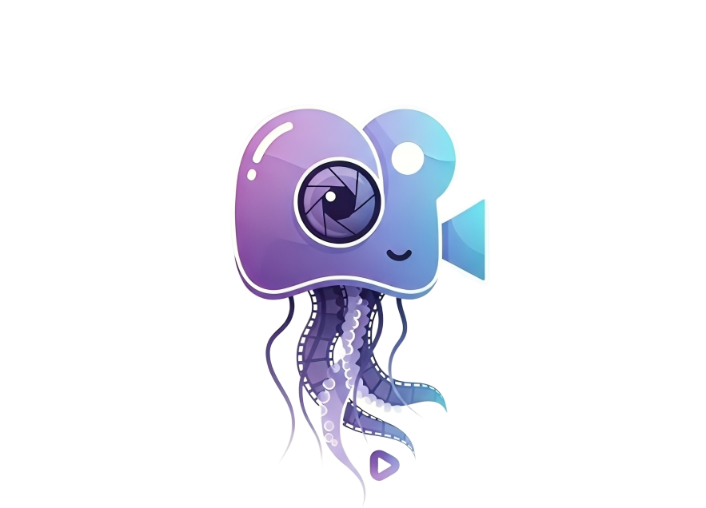
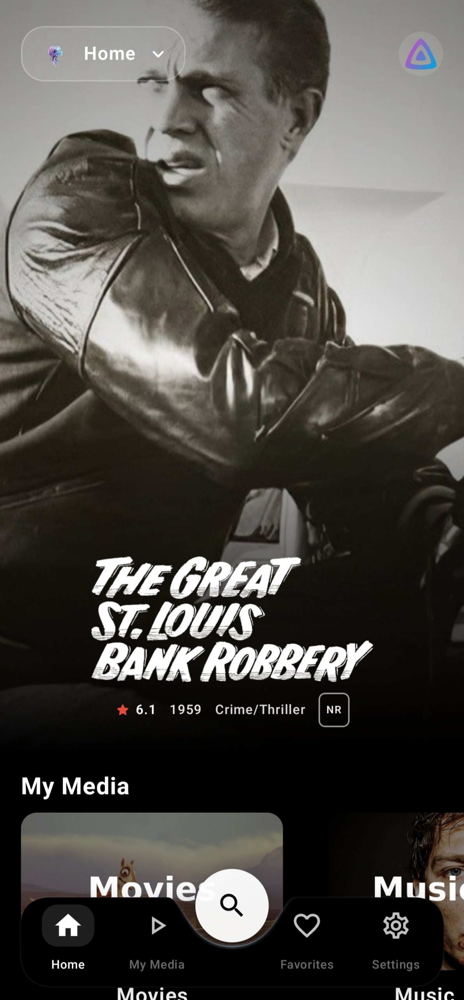
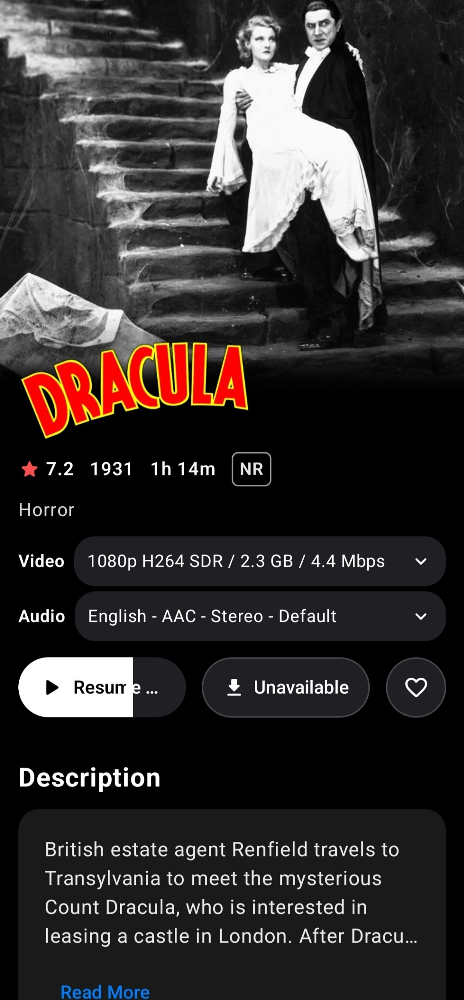
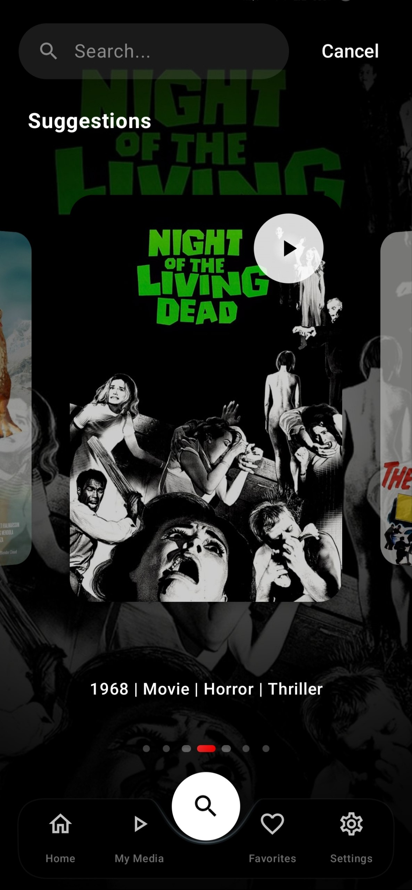
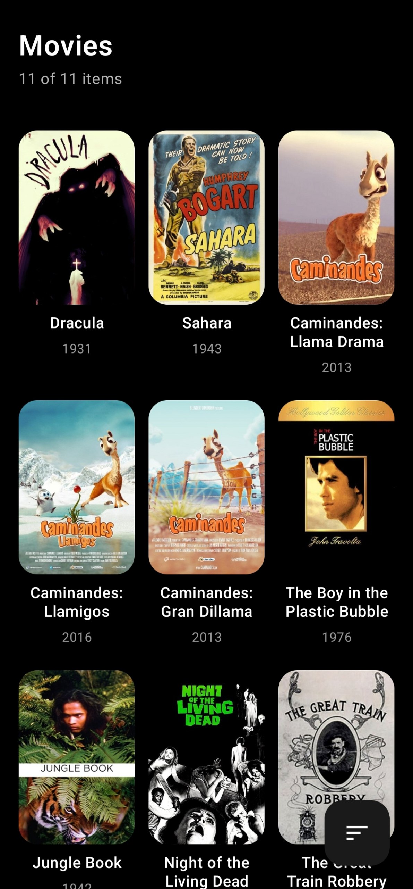
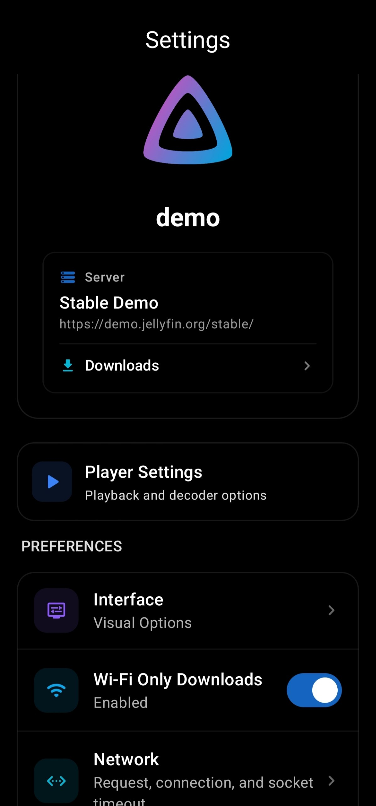
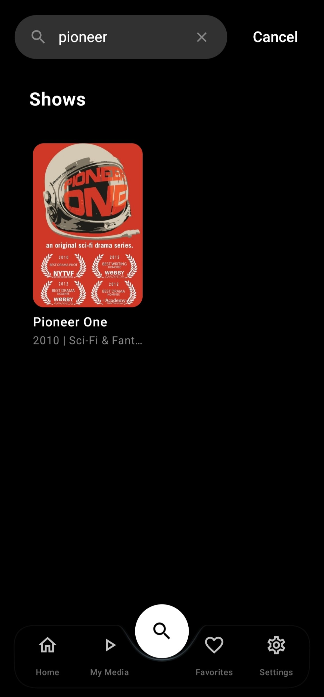

<p align="center">
  
</p>

<h1 align="center">JellyCine</h1>

<p align="center">
   A Jetpack Compose based client for <strong>Jellyfin</strong> and <strong>Emby</strong> — designed for phone, TV, and beyond.
</p>

<p align="center">
  <a href="https://play.google.com/store/apps/details?id=com.jellycine.app">
    
  </a>
  <a href="https://github.com/sureshfizzy/JellyCine/releases">
    
  </a>
</p>

<p align="center">
  <a href="https://www.buymeacoffee.com/Sureshfizzy">
    
  </a>
  <a href="https://www.patreon.com/c/sureshs/membership">
    
  </a>
</p>

---

## Features

### Playback

- **Custom MPV player** set as default engine — built from a custom fork with HDR10/HDR10+/Dolby Vision support and format badges
- HDR passthrough with dynamic dataspace switching and headroom hints (Android 14+)
- Configurable tone-mapping, rendering quality, and GPU filter settings
- Audio passthrough (TrueHD, DTS-HD, Atmos) when supported by device/output
- Spatial audio passthrough on compatible devices
- Media3 ExoPlayer fallback when MPV cannot render
- Jellyfin FFmpeg extension integration for broad codec coverage
- In-player quality selection, audio transcoding controls, and configurable player cache
- Gesture controls (seek, volume, brightness), lock mode, and start-maximized preference
- Skip Intro button when IntroDB/TheIntroDB markers are available
- Track selection dialog with format badges and AMOLED styling
- Subtitle styling controls with improved track handling
- Google Cast with inline remote playback controls

### Discovery

- **In-app Trailers** with autoplay in feature carousel (capped to 720p on phones)
- Trailers & Extras section on detail screens
- **For You** personalized recommendations with watched feed
- Awards category powered by Wikidata
- Immersive search with suggestions, live results, and categorized output
- Favorites tab with compact header and view-all navigation

### Seerr Integration

- Discovery, search, recommendations, and detail pages
- Request badges, request limits, and title requests
- Trailer support for Seerr detail items

### Downloads

- Offline downloads with queue, pause/resume/cancel, and persistent state recovery
- **Transcoded download support** with quality picker
- Audio track selection in download quality picker
- Season and series download with storage estimation
- Offline-aware navigation — falls back to downloaded content when network is unavailable

### TV

- Redesigned TV UI with D-pad navigation and remote control support
- Cinematic full-bleed detail screen overlay
- Immersive backdrop for suggestions
- Keyboard overlay search with carousel results
- Feature hero card with card expand and backdrop crossfade

### Screen Time

- Watch activity stats with daily breakdown charts
- Watched items list with poster images and media type filter
- Dual chart filters for media type and time range
- Week and month navigation for historical viewing
- Tablet-optimized layout

### Multi-Server & Connections

- Jellyfin and Emby support with automatic endpoint resolution
- Merge-version support with local version selection (no server-side changes required)
- **Discord Rich Presence** via official Social SDK with connection management
- **Admin Panel** with live server info, now-playing sessions, and activity log

### Platforms

| Platform | Status |
|----------|--------|
| Android Phone | Stable |
| Android TV | Stable |
| iOS | In Development |

---

## Screenshots

<div align="center">
  
  
  
</div>

<div align="center">
  
  
  
</div>

---

## Tech Stack

| Layer | Technology |
|-------|-----------|
| Language | Kotlin 2.3, Coroutines, Flow |
| UI | Jetpack Compose + Material 3 |
| DI | Hilt + KSP |
| Networking | Ktor Client + OkHttp 5 |
| Images | Coil 3 |
| Player | MPV (primary), Media3 ExoPlayer (fallback) |
| Multiplatform | Kotlin Multiplatform (Android + iOS) |

## Project Structure

```
phone/   — Phone app module (Compose UI, navigation, player, settings)
tv/      — TV app module (leanback/DPAD, sidebar rail, TV-specific flows)
data/    — APIs, repositories, models; multiplatform networking
core/    — Shared player, preferences, and utilities
shared/  — Shared UI components and image infrastructure
```

---

## Getting Started

### Prerequisites

- Android Studio (latest stable)
- JDK 17
- Android SDK API 36

### Build

```bash
# Phone
./gradlew :phone:assembleDebug

# TV
./gradlew :tv:assembleDebug
```

APK naming: `jellycine-{debug|release}-<version>.apk`

### Discord Rich Presence

Rich Presence shows the title you are playing on your Discord profile. It uses Discord’s Social SDK, shipped as `discord_partner_sdk.aar`.

That file is not in this repository. Discord’s [Social SDK Terms](https://support-dev.discord.com/hc/en-us/articles/30225844245271) allow the SDK inside an application. They do not allow publishing the SDK binary itself.

Official releases are built with the file present, so those APKs include Rich Presence. A clone does not, until you add it.

If the file is missing, the app still build and run. Gradle skips the Discord native library. Settings → Connections shows Seerr only, and playback does not start Rich Presence.

#### Add the SDK

The download is the same SDK for every Discord application. You do not need to change JellyCine’s application id. That id already lives in `DiscordRpcManager`.

1. Open the [Discord Developer Portal](https://discord.com/developers/applications) and sign in.
2. Open an application you manage. If you have none, create one and assign it to a [developer team](https://discord.com/developers/teams).
3. In that app’s sidebar, open **Discord Social SDK → Getting Started**, fill in the form, and submit it. Downloads stay locked until this is done.
4. Open **Discord Social SDK → Downloads**.
5. Pick the latest version and download the Android package. The file you need is `discord_partner_sdk.aar`. If the download is a zip, take that `.aar` out of the archive.
6. Copy it to this exact path, with this exact name:

```text
core/libs/discord_partner_sdk.aar
```

7. Sync Gradle, or rebuild from the repo root:

```bash
./gradlew :phone:assembleDebug
```

After you install that build, Discord is under **Settings → Connections**. The Discord app has to be installed on the device for the activity to show on your profile.

#### Update the SDK

1. Download a newer Android package from the same Downloads page.
2. Replace `core/libs/discord_partner_sdk.aar`. Do not rename it.
3. Clean `:core` so the previous native build is not reused, then rebuild:

```bash
./gradlew :core:clean :phone:assembleDebug
```

---

## Translating

<a href="https://weblate.jellycine.org/engage/jellycine/">

</a>

Help translate JellyCine into your language on [Weblate](https://weblate.jellycine.org/engage/jellycine/).

---

## Contributing

Issues and pull requests are welcome. For large feature work, open an issue first to align on scope.

For community discussions and support, see [Discussions](https://github.com/sureshfizzy/JellyCine/discussions).

---

## Privacy

See [PRIVACY](PRIVACY) for the current privacy policy.

## License

This project is licensed under the [GNU General Public License v3.0](LICENSE).